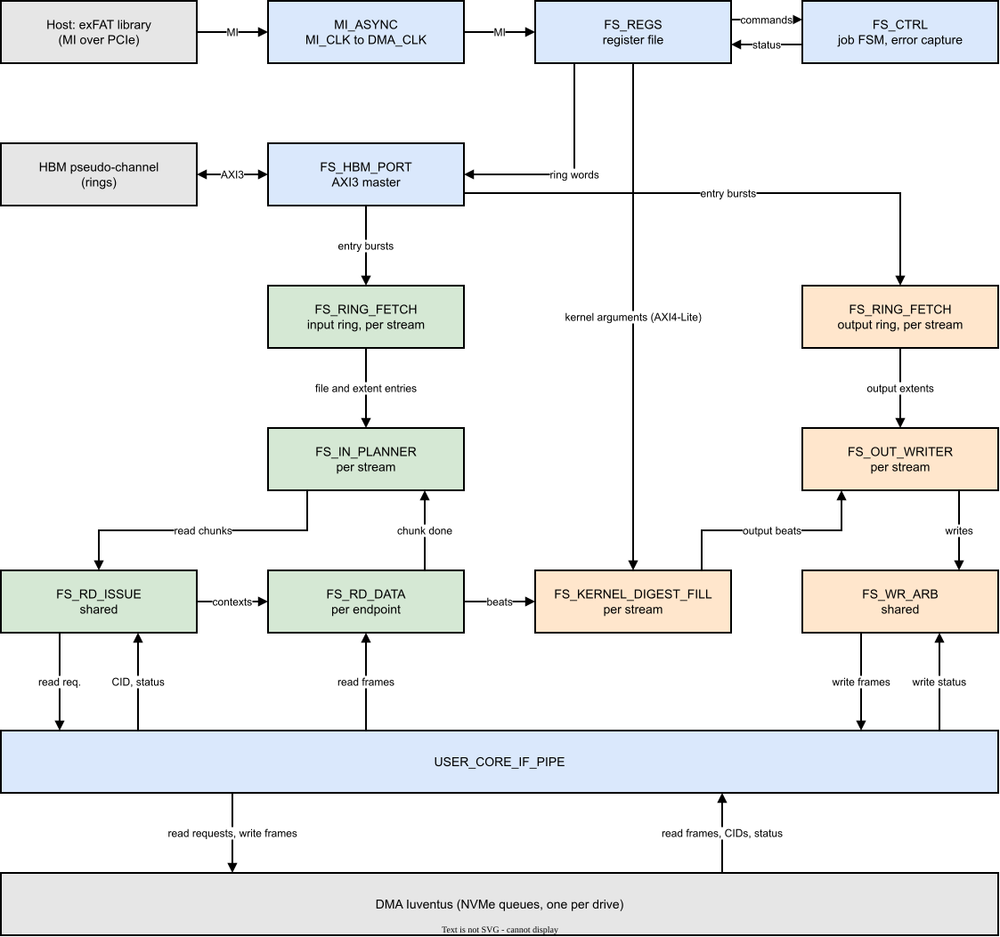

.. readme.rst: FILE_SHELL, the Iuventus file shell that runs kernels on files of an exFAT volume
   Copyright (C) 2026 Universitaet Heidelberg, Institut fuer Technische Informatik (ZITI)
   Author(s): Vladislav Valek <vladislav.valek@stud.uni-heidelberg.de>
   SPDX-License-Identifier: CC-BY-4.0

.. _iuventus_file_shell:

FILE_SHELL
----------

The file shell reads whole files from the NVMe drives behind DMA Iuventus, passes their bytes to a
kernel, and writes the kernel's output into another file on the same drives. The host describes
each file as a list of extents (runs of LBAs). The shell does all reads and writes itself. The host
only fills two rings per stream, starts the job and polls its status.

Up to eight independent streams run in one job. Each stream has its own input file list, its own
kernel instance and its own output file. The only built-in kernel is DIGEST_FILL (``KERNEL_ID`` 1).

Where it sits
^^^^^^^^^^^^^

The shell is the whole ``FILES`` architecture of the app's ``USER_CORE``
(``apps/iuventus/comp/user_core_file_arch.vhd``). Build the app with ``USR_CORE_ARCH=FILE`` to
select it. The shell then owns:

* the USER_CORE MI window, 32 MiB, published in the device tree as ``ziti,iuventus_file_shell``;
* HBM port 0, which runs on ``DMA_CLK`` and holds the rings;
* the USER_CORE read and write interfaces of DMA Iuventus.

Every NVMe queue of the DMA serves one drive. The shell stripes a logical volume (RAID0) over 1, 2
or 4 of these drives.

Everything runs on ``DMA_CLK``. Only the MI slave crosses from ``MI_CLK``, through ``MI_ASYNC``.

The host side lives in ``apps/iuventus/sw/exfat_layer``. The library owns the exFAT metadata. It
resolves the input files into extents, reserves clusters for the output, and runs the job through
``iuv_exfat::Job`` (``src/job.cpp``). ``iuv-exfat`` (command line) and ``iuv-fs`` (FUSE daemon) are
built on it. Without a card they run the same jobs on a software model of the shell
(``src/file_shell_model.cpp``). Their use is described in the section *Files on the exFAT volume*
of the `host tooling README <../../sw/README.rst>`_.

Block diagram
^^^^^^^^^^^^^

Blue blocks are control, green blocks the read path, orange blocks the kernel and the write path.
Grey boxes are outside the shell. ``FS_CTRL`` also drives CLEAR, START, ENABLE, ABORT and SINK into
the stream blocks and takes their error and progress signals; these wires are not drawn.

Job model
^^^^^^^^^

Rings and entries
~~~~~~~~~~~~~~~~~

Each stream has an input ring of 2^16 entries and an output ring of 2^14 entries. Both rings live
in the HBM. The host writes them through MI windows (see the register map). An entry is 16 B, four
32-bit words, word *k* holding bits 32k+31..32k.

.. list-table:: Ring entry
   :header-rows: 1
   :widths: 15 25 60

   * - Bits
     - Field
     - Meaning
   * - 47:0
     - LBA or SIZE
     - EXTENT: first logical LBA. FILE: file size in bytes.
   * - 63:48
     - reserved
     - Must be 0.
   * - 95:64
     - COUNT or INDEX
     - EXTENT: number of LBAs, not 0. FILE: file index, handed to the kernel with every beat.
   * - 97:96
     - TYPE
     - ``00`` EXTENT, ``01`` FILE. Other values are malformed.
   * - 126:98
     - reserved
     - Must be 0.
   * - 127
     - LAST
     - Marks the last entry of the input list. Never set in an output entry.

An LBA is 512 B. A logical LBA is mapped onto the stripe: with ``2^D`` drives and chunks of ``2^C``
LBAs, the drive is ``(lba >> C) mod 2^D`` and the drive's own LBA is
``((lba >> D) & ~(2^C-1)) | (lba & (2^C-1))``.

**Input list.** Each file is a FILE entry followed by its EXTENT entries in file order. The LAST bit
ends the list. The host builds it in that order (``Job::submit``). A file of size 0 has no extents.
Extents may cover more LBAs than the file needs; the surplus is ignored. The list is malformed when
an EXTENT comes before any FILE, when a file's extents end before its size is covered, or when the
list ends that way.

**Output ring.** It holds EXTENT entries only, without LAST. The shell takes an entry only while
output remains to be written. The last LBA written is padded with zeros.

Running a job
~~~~~~~~~~~~~

The host library does the following (``Job::submit`` and ``Job::wait``):

#. Check ``VERSION`` (1) and ``KERNEL_ID``, and read the ring depths from ``RING_DEPTHS``.
#. Write CLEAR and wait until ``BUSY`` is low. CLEAR zeroes the tails at once. The datapath clear
   follows once the datapath is idle.
#. Per stream: write the ring entries, then the new ``IN_TAIL`` and ``OUT_TAIL``, then the kernel
   arguments.
#. Write ``STRIPE`` and ``STREAM_MASK``. Both are ignored while ``BUSY`` is high.
#. Write START.
#. Poll ``STATUS``. Push more input entries as ring space frees. On ``NEED_SPACE``, extend the
   output file and push its new extents.
#. On DONE, read ``IN_FILES``, ``IN_BYTES`` and ``OUT_BYTES`` of each stream. ``OUT_BYTES`` is the
   output file's final size. On ERR, read ``STREAM_STATUS`` and ``ERR_INFO`` of each stream.

A tail is a free-running 32-bit entry count; the slot is ``tail mod depth``. ``HEAD`` counts the
entries the shell has consumed, so the host may reuse every slot below it. A tail write waits until
all earlier ring writes are acknowledged by the HBM, so the shell never fetches a stale entry.

Completion
~~~~~~~~~~

``FS_CTRL`` holds the job state, visible in ``STATUS[15:8]``:

.. list-table:: Job states
   :header-rows: 1
   :widths: 10 15 75

   * - Value
     - State
     - Meaning
   * - 0
     - IDLE
     - No job. START is executed once no CLEAR waits and the datapath is idle.
   * - 1
     - RUN
     - Masked streams are enabled.
   * - 2
     - DRAIN
     - An error, ABORT or CLEAR stopped the job. Read frames still arriving are discarded.
   * - 3
     - DONE
     - The job finished without error.
   * - 4
     - ERR
     - The job failed. Read frames are still discarded.

RUN moves to DONE when every masked stream reports ``IN_DONE`` and ``OUT_DONE``, the datapath has
been idle for three samples, and no read frame has ended for ``DONE_QUIET`` cycles. The quiet window
exists because a DMA DATA_LOST status arrives after its frame. DRAIN waits for the same idle and
quiet conditions, then moves to ERR, or to IDLE when a CLEAR caused it. DONE and ERR stay until the
next CLEAR. A START with a bad ``STRIPE`` goes from IDLE straight to ERR.

``BUSY`` is high in RUN and DRAIN, and while a START waits.

Data path
^^^^^^^^^

Per stream there is one input ``FS_RING_FETCH``, one output ``FS_RING_FETCH``, one
``FS_IN_PLANNER``, one kernel and one ``FS_OUT_WRITER``. ``FS_RD_ISSUE``, ``FS_WR_ARB``,
``FS_HBM_PORT``, ``FS_REGS`` and ``FS_CTRL`` are shared. There is one ``FS_RD_DATA`` per PCIe
endpoint. ``USER_CORE_IF_PIPE`` registers the DMA interface and is shared with the other USER_CORE
architectures.

FS_REGS
   The MI register file. It serves one access at a time and acknowledges it only when it has
   completed. Ring window accesses become single 32-bit HBM accesses. Kernel argument accesses are
   forwarded over AXI4-Lite to the stream's kernel. CTRL bits are one-cycle pulses.

FS_HBM_PORT
   The AXI3 master on the HBM port (256-bit data, 34-bit address, 6-bit IDs, INCR bursts). Clients
   are the MI ring access and one burst-read client per ring (``2 * STREAMS``). MI reads win the AR
   channel; fetchers share it round-robin. The ID is the client index, so each client gets its
   bursts in order. An MI read waits for all MI writes to be acknowledged. Any non-OKAY ``RRESP`` or
   ``BRESP`` sets the sticky ``HBM_ERR``. The AXI side resets only with ``HBM_RESET``; after a
   ``RESET`` the port answers what is still in flight before it takes new requests.

FS_RING_FETCH
   Prefetches the entries between its fetch pointer and ``TAIL`` into a 64-entry FIFO. Bursts have
   up to 16 beats (32 entries) and never cross a 4 KiB page. Up to ``FS_FETCH_MAX_OUT`` (8) bursts
   are in flight. A beat carries two entries, so the FIFO is split into an even and an odd half. It
   fetches only while ``ENABLE`` is high. Bursts issued before a CLEAR are drained and discarded.

FS_IN_PLANNER
   Parses the input list and cuts each file into read chunks. A chunk ends at the end of the extent,
   at a stripe chunk boundary, or at the file's last LBA, so it never exceeds ``2^C`` LBAs (at most
   256, 128 KiB) and lies on one drive. Each chunk request carries the drive (queue), the drive LBA,
   the LBA count and a context: stream, file slot, file index, offset in the file, offset in the
   stream and the number of valid bytes. A file holds one of 64 file slots until all its chunks are
   delivered. Slots retire in list order and count ``IN_FILES``. When the LAST entry is parsed and
   every slot retired, it raises ``IN_DONE`` and ends the kernel's input. A malformed entry raises a
   FORMAT error.

FS_RD_ISSUE
   Arbitrates the chunk requests of all streams round-robin and issues them as DMA reads. A stream
   is served only when its queue has a credit, the queue's context FIFO has room and the endpoint's
   issue window is open. It keeps the context per queue until the DMA accepts the read, then stores
   it under ``{qid, cid}`` when the DMA returns the read's CID. The DMA frees a tag at the
   completion, before the frame has drained, so the frame cannot be matched by its tag. Instead, a
   successful read status looks the context up and queues it per endpoint (512 entries); frames
   arrive in the order of their success status. Failed and out-of-range reads become read errors.

FS_RD_DATA
   Takes one endpoint's read frames. A frame waits at its SOF for the next context, then is cut into
   64 B beats for the stream's kernel. Each beat carries its valid byte count, file index, file
   offset and stream offset. Beats wholly past the file's end are dropped. After the last beat it
   reports the chunk done to the planner, and the bytes delivered for ``IN_BYTES``. A stalled kernel
   stalls the endpoint; nothing is dropped. With ``SINK`` high (DRAIN, ERR) frames are discarded.

FS_KERNEL_DIGEST_FILL
   Kernel 1. It takes one input lane per endpoint. For every 8-byte word ``w`` at file offset ``o``
   of file ``f`` it forms ``w xor o xor (f << 40)`` and accumulates the 64-bit sum and xor of these
   values. Both are independent of the order in which beats arrive. Its output is ``FILL_BYTES`` of
   a pattern (word *j* = ``((j xor SEED) << 32) | j``) followed by a 32 B record: input bytes, sum,
   xor (64 bits each), file count and the magic ``0x31474944`` (32 bits each). Its arguments are
   ``0x00`` FILL_BYTES low, ``0x04`` FILL_BYTES high, ``0x08`` SEED. A ``FILL_BYTES`` that is not a
   multiple of 64 raises ``ARG_ERR`` one cycle after START. The bench reference is
   ``model/fs_kernel_digest_fill_model.py``.

FS_OUT_WRITER
   Stages the kernel output in a URAM buffer of ``2^STAGE_LOG2_BEATS`` 64 B beats. It pops output
   extents, maps them onto the stripe like the planner, and issues one write per chunk once the
   chunk's data is staged. The final write is padded with zeros to whole LBAs. When output waits and
   the output ring is empty (``OUT_HEAD`` = ``OUT_TAIL``) it raises ``NEED_SPACE``. A malformed
   entry raises a FORMAT error; the writer then halts and discards the kernel output, so the kernel
   still drains. ``OUT_DONE`` rises when all output is written and every write has completed.

FS_WR_ARB
   Grants the writers round-robin, one whole frame at a time, and drives the DMA write stream. Its
   meta is ``{qid, lba}``. Drives complete a queue's writes in any order, so it keeps a FIFO per
   queue (72 entries) and the set of streams that wrote the queue since it last drained. A
   successful write status adds the head entry's bytes to that stream's ``OUT_BYTES``; the counts
   are exact once every write has completed. A failed write fails every stream in the queue's set.

FS_CTRL
   The job FSM described above. It collects the errors of all blocks, latches the first one per
   stream into ``ERR_INFO``, and sums ``IN_BYTES``. CLEAR and START reach the datapath only while it
   is idle, so no write frame is cut and no completion of an old job is counted in a new one. On the
   way from RUN to DRAIN it pulses ``PLANE_ABORT``.

Register map
^^^^^^^^^^^^

All offsets are bytes within the shell's MI window. The shell decodes the low 25 bits. The host
constants in ``apps/iuventus/sw/exfat_layer/src/job.cpp`` match this map. Unmapped addresses read 0.

.. list-table:: Global registers
   :header-rows: 1
   :widths: 10 18 8 64

   * - Offset
     - Name
     - Access
     - Content
   * - 0x00
     - CTRL
     - W
     - bit 0 START, bit 1 ABORT, bit 2 CLEAR (pulses).
   * - 0x04
     - STATUS
     - R
     - bit 0 BUSY, bit 1 DONE, bit 2 ERR, bit 3 NEED_SPACE (OR over streams), bits 15:8 job state.
   * - 0x08
     - STREAM_MASK
     - RW
     - One bit per stream. Written only while not BUSY. Reset 0.
   * - 0x0C
     - VERSION
     - R
     - Layout version, 1.
   * - 0x10
     - RING_DEPTHS
     - R
     - bits 7:0 log2 input ring depth (16), bits 15:8 log2 output ring depth (14).
   * - 0x14
     - KERNEL_ID
     - R
     - Kernel built in, 1 (DIGEST_FILL).
   * - 0x18
     - STRIPE
     - RW
     - bits 3:0 log2 drives, bits 11:8 log2 LBAs per chunk. Written only while not BUSY. Reset:
       drives 2, chunk 8.

Stream *s* has its block at ``0x100 + s * 0x40`` for *s* < ``STREAMS``.

.. list-table:: Stream registers
   :header-rows: 1
   :widths: 10 20 8 62

   * - Offset
     - Name
     - Access
     - Content
   * - 0x00
     - IN_FILES
     - R
     - Input files fully delivered to the kernel, size-0 files included.
   * - 0x08
     - IN_TAIL
     - RW
     - Input entries written by the host. Zeroed by CLEAR.
   * - 0x0C
     - IN_HEAD
     - R
     - Input entries consumed by the shell.
   * - 0x10
     - OUT_TAIL
     - RW
     - Output entries written by the host. Zeroed by CLEAR.
   * - 0x14
     - OUT_HEAD
     - R
     - Output entries consumed by the shell.
   * - 0x18
     - OUT_BYTES_LO
     - R
     - Output bytes written successfully, bits 31:0. Reading it latches the high word.
   * - 0x1C
     - OUT_BYTES_HI
     - R
     - Bits 63:32, as latched by the last read of OUT_BYTES_LO.
   * - 0x20
     - STREAM_STATUS
     - R
     - bit 0 IN_DONE, bit 1 OUT_DONE, bit 2 NEED_SPACE, bit 3 ERR.
   * - 0x24
     - ERR_INFO
     - R
     - First error of the stream, see below.
   * - 0x28
     - IN_BYTES_LO
     - R
     - Input bytes delivered to the kernel, bits 31:0. Reading it latches the high word.
   * - 0x2C
     - IN_BYTES_HI
     - R
     - Bits 63:32, as latched by the last read of IN_BYTES_LO.

.. list-table:: Windows
   :header-rows: 1
   :widths: 28 72

   * - Range
     - Content
   * - 0x1000 + s * 0x200
     - Kernel arguments of stream *s*, 512 B, forwarded over AXI4-Lite. A window of a stream that is
       not built answers with zeros.
   * - 0x0800000 + s * 0x40000
     - Output ring of stream *s*, 2^14 entries of 16 B. HBM bytes 0x000000 onwards.
   * - 0x1000000 + s * 0x100000
     - Input ring of stream *s*, 2^16 entries of 16 B. HBM bytes 0x800000 onwards.

Both ring windows map into the first 16 MiB of the port, offset by ``HBM_BASE``.

Error reporting
^^^^^^^^^^^^^^^

Any error moves the job to DRAIN and then ERR. ``STREAM_STATUS.ERR`` marks each stream the error
was attributed to. ``ERR_INFO`` keeps the first error of each stream. When several sources hit a
stream in the same cycle, the planner wins, then the writer, the kernel, read errors, write errors,
the HBM and ABORT. CLEAR zeroes both.

.. list-table:: ERR_INFO
   :header-rows: 1
   :widths: 12 18 70

   * - Bits
     - Field
     - Meaning
   * - 1:0
     - CODE
     - DMA status code: ``00`` OK, ``01`` failed, ``10`` LBA out of range, ``11`` DATA_LOST.
   * - 2
     - INPUT
     - 1 for the read side and the input list, 0 for the write side and the output ring.
   * - 7:4
     - DRIVE
     - The queue (drive) of the failed command.
   * - 11:8
     - SOURCE
     - 0 NVME, 1 FORMAT, 2 ABORT, 3 HBM.
   * - 31:16
     - CID / INDEX
     - NVME: the command's CID. FORMAT: the 1-based index of the offending ring entry, modulo 65536.

.. list-table:: Error sources
   :header-rows: 1
   :widths: 22 30 48

   * - Cause
     - ERR_INFO
     - Streams failed
   * - Read failed (``01``)
     - NVME, code, INPUT 1, drive, CID
     - The stream that issued the read.
   * - Read out of range (``10``)
     - NVME, code, INPUT 1, drive 0, CID 0
     - The stream of the read waiting for its CID; all streams if none waits.
   * - Read DATA_LOST (``11``)
     - NVME, code, INPUT 1, drive, CID
     - All streams: the tag may already serve a newer read.
   * - Write failed or DATA_LOST
     - NVME, code, INPUT 0, drive, CID
     - Every stream that wrote the queue since it last drained.
   * - Write out of range (``10``)
     - NVME, code, INPUT 0, drive 0, CID 0
     - Every stream with a write outstanding.
   * - Malformed input entry
     - FORMAT, INPUT 1, entry index
     - The stream.
   * - Malformed output entry
     - FORMAT, INPUT 0, entry index
     - The stream.
   * - Bad STRIPE at START, or kernel ``ARG_ERR``
     - FORMAT, INPUT 0, index 0
     - Every masked stream (STRIPE), or the stream (``ARG_ERR``).
   * - Non-OKAY HBM response
     - HBM
     - Every masked stream.
   * - CTRL ABORT
     - ABORT
     - Every masked stream.

``STRIPE`` is bad when log2 chunk is outside 1..8 or log2 drives exceeds
``min(2, log2(NUM_QUEUES))``. The host decodes ``ERR_INFO`` in ``describe_err_info``
(``src/job.cpp``) with the same field layout.

Generics
^^^^^^^^

.. list-table:: FILE_SHELL generics
   :header-rows: 1
   :widths: 22 12 12 54

   * - Generic
     - Default
     - In the app
     - Meaning
   * - STREAMS
     - 8
     - 8
     - Streams built, 1 to 8.
   * - NUM_QUEUES
     - 4
     - app
     - DMA NVMe queues, one per drive.
   * - PCIE_ENDPOINTS
     - 1
     - app
     - Read endpoints; one FS_RD_DATA and one kernel lane each. Must divide NUM_QUEUES.
   * - KERNEL_ID
     - 1
     - 1
     - Kernel built in. Only 1 (DIGEST_FILL) exists.
   * - MI_WIDTH
     - 32
     - app
     - MI data and address width.
   * - MFB_REGION_SIZE, MFB_BLOCK_SIZE, MFB_ITEM_WIDTH
     - 1, 64, 8
     - app
     - DMA user MFB. Must form one 512-bit region of 64 bytes.
   * - CID_W
     - 16
     - app
     - NVMe CID width. Must be 16.
   * - IF_PIPE_STAGES
     - 6
     - 6
     - Register stages of USER_CORE_IF_PIPE.
   * - IF_PIPE_REQ_ITEMS
     - 16
     - 16
     - Read request credits per queue in USER_CORE_IF_PIPE.
   * - STAGE_LOG2_BEATS
     - 12
     - 12
     - Writer staging buffer per stream, in 64 B beats (12: 256 KiB). Must hold one stripe chunk.
   * - DONE_QUIET
     - 1024
     - 1024
     - Cycles without a read frame end before DONE or ERR.
   * - HBM_BASE
     - 0
     - 0
     - HBM byte address of ring offset 0.
   * - DEVICE
     - ULTRASCALE
     - app
     - FPGA family, for FIFOX and MI_ASYNC.

"app" means the value is passed through from USER_CORE.

Limits
^^^^^^

Fixed in ``fs_pkg.vhd`` and the block generics set by ``file_shell.vhd``:

* Streams: 8. Input ring: 2^16 entries, output ring: 2^14 entries per stream.
* LBA: 512 B, 48-bit LBAs. File size: below 2^48 bytes. EXTENT COUNT: 32 bits.
* Stripe: up to 4 drives and no more than NUM_QUEUES; chunk of 2 to 256 LBAs.
* Open files per stream with reads outstanding: 64.
* Reads issued and not yet started per endpoint: 512 (``XCTX_ITEMS``). Contexts waiting for the
  DMA's accept: 64 per queue. The DMA tag pool: 64 CIDs per queue.
* Write completion FIFO: 72 entries per queue.
* Ring fetch FIFO: 64 entries per ring, up to 8 bursts in flight.
* ``ERR_INFO`` entry index: 16 bits, so it wraps every 65536 entries.
* Kernel argument window: 512 B per stream.

Verification
^^^^^^^^^^^^

Every block has its own cocotb bench in ``cocotb_fs_<block>/``, each with a Python model in
``model/``. ``tb/`` holds shared helpers, among them a multi-queue DMA model with fault injection.
``cocotb_fs.mk`` holds what all benches share: the nvc flow with PSL checks on
(``NVC_PSL=1``), abort on error, and the ``PYTHONPATH`` to the models and helpers. Every bench
seeds its traffic from cocotb's random seed.

.. list-table:: Benches
   :header-rows: 1
   :widths: 30 25 45

   * - Directory
     - DUT
     - Knobs (default)
   * - cocotb_fs_regs
     - FS_REGS
     - STREAMS (8)
   * - cocotb_fs_hbm_port
     - FS_HBM_PORT
     - FETCHERS (16)
   * - cocotb_fs_ring_fetch
     - FS_RING_FETCH
     - LOG2_DEPTH (9), RING_BASE (12288), FIFO_ENTRIES (64)
   * - cocotb_fs_in_planner
     - FS_IN_PLANNER
     - STREAM_IDX (5), CDONE_LANES (2)
   * - cocotb_fs_rd_issue
     - FS_RD_TB_TOP: FS_RD_ISSUE and FS_RD_DATA behind USER_CORE_IF_PIPE
     - XCTX_ITEMS (32), STAGES (6)
   * - cocotb_fs_rd_data
     - FS_RD_DATA
     - STREAMS (8)
   * - cocotb_fs_kernel_digest_fill
     - FS_KERNEL_DIGEST_FILL
     - LANES (2)
   * - cocotb_fs_out_writer
     - FS_OUT_WRITER
     - STAGE_LOG2_BEATS (9)
   * - cocotb_fs_wr_arb
     - FS_WR_ARB
     - STREAMS (8), CPL_FIFO_ITEMS (72)
   * - cocotb_fs_ctrl
     - FS_CTRL
     - STREAMS (8), NUM_QUEUES (4), PCIE_ENDPOINTS (1), DONE_QUIET (1024)

The system bench ``apps/iuventus/comp/cocotb_file_arch`` runs ``USER_CORE`` with the FILES
architecture as the app instantiates it: four queues, two endpoints, one 512-bit region. It drives
random jobs the way ``iuv_exfat::Job`` issues them, on volumes striped over 1, 2 or 4 drives, and
checks drive contents, counters and status words against ``file_shell_model``. It also covers
NEED_SPACE, read and write errors, ABORT, format errors and a job on an exFAT image.

Run a bench from its directory:

.. code-block:: bash

   source env.sh                       # with cocotb and pytest in the active Python environment
   cd apps/iuventus/comp/file_shell/cocotb_fs_ctrl
   make                                # analyse, elaborate and run all tests in nvc
   make RANDOM_SEED=1234               # repeat one seed
   make STREAMS=2 PCIE_ENDPOINTS=2     # another corner, through the bench's knobs
   make nvc-elab                       # build once ...
   make nvc-run RANDOM_SEED=1          # ... then run it with many seeds

The system bench runs the same way from ``apps/iuventus/comp/cocotb_file_arch``.
