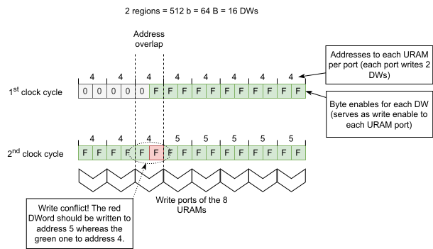

.. _tx_dma_calypte_trans_buffer:

Transaction buffer
==================

.. vhdl:autoentity:: TX_DMA_PCIE_TRANS_BUFFER

Implementation notes
--------------------

The entity selects one of two implementations:

* the ``BYTE`` architecture of ``TX_DMA_PCIE_TRANS_BUFFER_IMPL``, an array of one BRAM per
  byte lane of the MFB word
  (``SDP_BRAM_BE`` for 1 region, ``DP_BRAM_BEHAV`` for 2 regions), serves every Intel device and
  every AMD instance that needs none of the features below. On Intel, :vhdl:genconstant:`RAM_TYPE`
  must be ``"AUTO"`` or ``"BRAM"`` and :vhdl:genconstant:`MEM_PARTITIONING` and
  :vhdl:genconstant:`READ_LATENCY` must keep their defaults; an elaboration assertion rejects
  anything else.
* the ``BANKED`` architecture of ``TX_DMA_PCIE_TRANS_BUFFER_IMPL``, two even/odd row banks of
  XPM memories, serves an AMD
  instance (7SERIES, ULTRASCALE, VERSAL) when the resolved primitive is URAM (``RAM_TYPE => "URAM"``,
  or ``"AUTO"`` as described below), ``MEM_PARTITIONING => FALSE`` or ``READ_LATENCY`` is not 1.
  Its architecture instantiates XPM macros, so ``Modules.tcl`` adds it only with the ``xilinx``
  PLATFORM_TAG and an empty architecture otherwise; an Intel build never analyses XPM.

Even/odd row banking (AMD)
^^^^^^^^^^^^^^^^^^^^^^^^^^

Rows with an even index live in bank 0, rows with an odd index in bank 1. A barrel-rotated write or
read of one MFB word spans at most two neighbouring rows, ``row`` and ``row + 1``, which always fall
into different banks, so each bank needs a single address per access plus per-byte write enables.
A 2-region instance uses one ``XPM_MEMORY_TDPRAM`` per bank (region 0 on port A, region 1 on port B;
a write stalls a read on the same port), a 1-region instance one ``XPM_MEMORY_SDPRAM`` per bank (a
read never stalls). Both banks receive the same rotated write data; on a read both are fetched and
recombined byte by byte before the optional read barrel shifter.

The banking is what makes URAM legal here. PCIe addresses DWords, and because of the internal barrel
shifter one bus word can hold the first DWord of a row and the last DWord of the previous row, which
must go to two different addresses. One 8 B URAM port cannot serve two rows in one cycle, so a
single-bank URAM array overwrites data; with banking the two DWords always fall into different banks.

   The write conflict of a single-bank URAM array, which the banking removes

:vhdl:genconstant:`RAM_TYPE` selects the primitive of each bank. ``"AUTO"`` resolves to URAM on an
UltraScale+ or Versal device for 2 regions when a bank is at least 2048 rows deep, BRAM otherwise;
``"URAM"`` forces URAM; ``"BRAM"``, like a resolved BRAM, keeps the per-byte buffer unless another
feature selects the banked one. URAM banks hold up to 16384 rows, BRAM arrays 4096, which sets how
many channels share one memory array. TX_DMA_CALYPTE with 32 or more channels at
``POINTER_WIDTH => 13`` therefore uses the banked URAM buffer, with 16 channels the per-byte one.

PCIe never addresses a lone byte: a sub-DWord access is expressed by FirstBE/LastBE, and the write
barrel shifters rotate by whole DWords, so a byte's row and bank follow from its DWord lane and its
enable bit carries the rest. Two transactions packed into one bus word may touch the same DWord with
disjoint byte enables, which both primitives handle. If both ports write the same byte in one cycle,
URAM keeps region 1 (port B executes after port A), BRAM leaves the byte undefined; the simulation-only
collision checks flag that case.

Verification
^^^^^^^^^^^^

``cocotb/`` holds a cocotb bench (nvc) with a byte-accurate reference model
(``trans_buffer_model.py``). It covers aligned and unaligned writes at every DWord offset with
FirstBE/LastBE patterns, two frames in one bus word to the same or different channels and memory
arrays, channel buffer wraparound, randomized traffic with reads racing the writes, where a no-op word
follows a transaction at random, and a 1 B write followed without a gap by a 64 B write to the next
byte. ``TB_COLLISION_PROBE=1`` adds a report-only sweep of a read against a write to the same row.
The log names the implementation under test and, for the banked one, counts the cycles in which a
read colliding with the other region's write was withheld. Every test reseeds from
``COCOTB_RANDOM_SEED``. The toplevel is a test-only wrapper that takes
:vhdl:genconstant:`READ_BARREL_SHIFTER_EN` as the bit mask ``READ_BARREL_SHIFTER_MASK`` (bit ``p`` is
element ``p``), since nvc cannot set an array generic from the command line::

    cd cocotb
    make                                                    # defaults, AUTO -> banked URAM
    make NVC_ELAB_ARGS="-gRAM_TYPE=BRAM"                    # per-byte, two memory arrays
    make NVC_ELAB_ARGS="-gCHANNELS=32 -gPOINTER_WIDTH=13"   # 32 channels: banked URAM
    make NVC_ELAB_ARGS="-gREAD_BARREL_SHIFTER_MASK=1 -gCHANNELS=16 -gPOINTER_WIDTH=13"  # as TX_DMA_CALYPTE: per-byte
    make NVC_ELAB_ARGS="-gREAD_BARREL_SHIFTER_MASK=1 -gCHANNELS=32 -gPOINTER_WIDTH=13"  # as TX_DMA_CALYPTE with 32 channels: banked URAM
    make NVC_ELAB_ARGS="-gREAD_LATENCY=3 -gRAM_TYPE=BRAM"   # banked BRAM, registered read request
    make NVC_ELAB_ARGS="-gDEVICE=AGILEX"                    # per-byte on Intel, 2 regions
    make NVC_ELAB_ARGS="-gMEM_PARTITIONING=false -gCHANNELS=2 -gPOINTER_WIDTH=18 -gRAM_TYPE=BRAM"  # banked BRAM, flat

``cocotb_test.py`` drives the 2-region geometry only. ``cocotb_1region_smoke.py`` checks a 1-region
instance: data integrity of aligned, unaligned and wrapping writes, a read latency of one cycle for
both :vhdl:genconstant:`RAM_TYPE` values, and that a read racing a write to the same address drops
``RD_DATA_VLD_A`` in exactly the colliding cycle with the banked buffer and returns the old data with
the per-byte one::

    make COCOTB_TEST_MODULES=cocotb_1region_smoke NVC_ELAB_ARGS="-gMFB_REGIONS=1 \
        -gREAD_BARREL_SHIFTER_MASK=1 -gCHANNELS=16 -gPOINTER_WIDTH=13 -gRAM_TYPE=URAM"

On Intel the 1-region per-byte buffer uses ``altera_syncram``, which exists only as a SystemVerilog
model, so it elaborates in nvc but does not simulate there.

General subcomponents
---------------------
* :ref:`barrel_shifter`
* :ref:`sdp_bram`
